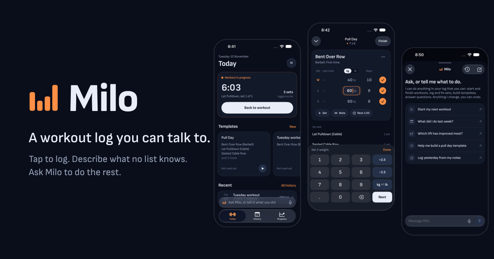

<!-- markdownlint-disable MD033 -->

<p align="center">
  
</p>

##  Milo

Milo is a workout log you can talk to.

You log sets by tapping, the way you would in any lifting app. When your trainer calls out a movement no preset list has heard of, you describe it and Milo works out what it is, saves it as your own exercise, and logs it.

Think: "Start my pull day, I did rows at 60 for 8 and 8" or "What have I neglected this month?" and it does it, or answers from your own log.

## What It Does

- Log workouts set by set, with last time's numbers filled in and a rest timer
- Works offline; the phone owns the log and syncs when it can
- Ask Milo: an agent that can do anything the buttons can (start and finish workouts, log and fix sets, build templates), with every change undoable and every edit or delete approved by you first
- Turns a described movement into a real exercise with muscles, equipment and how it's counted
- Mixed units: each exercise keeps kg or lb, and weights are stored exactly as typed
- Progress per exercise (top set, volume, estimated 1RM), new bests, and weeks trained
- Templates as plain ordered lists, with supersets
- Apple Health: saves finished workouts and calories, reads body weight
- Export everything as JSON and CSV

## Tech Stack

[](https://www.swift.org/)
[](https://developer.apple.com/swiftui/)
[](https://github.com/groue/GRDB.swift)
[](https://developer.apple.com/healthkit/)
[](https://go.dev/)
[](https://connectrpc.com/)
[](https://buf.build/)
[](https://www.postgresql.org/)
[](https://sqlc.dev/)
[](https://www.anthropic.com/claude)
[](https://golang.testcontainers.org/)

## Quick Start

```bash
cp .env.example .env    # set MILO_INVITE_CODE to anything
make up                 # Postgres on port 5433
make run                # the API on :8080
make ios                # opens the app in Xcode; press Run
```

In the app, create an account with the invite code from your `.env`.

Without `ANTHROPIC_API_KEY_MILO` everything works except Milo, which says it isn't set up.

## Manual Dev Setup

### 1. Install the tools

You need Go 1.27, Docker and Xcode 26, plus three tools from Homebrew:

```bash
brew install bufbuild/buf/buf sqlc xcodegen
```

### 2. Configure

```bash
cp .env.example .env
```

Set `MILO_INVITE_CODE` (sign-up is closed without one) and, to talk to Milo, `ANTHROPIC_API_KEY_MILO`.

### 3. Start infra

```bash
make up
```

### 4. Run backend (port 8080)

```bash
make run
```

It migrates the database on start.

### 5. Run the app

```bash
make ios
```

This generates `ios/Milo.xcodeproj` and opens it. Pick an iPhone simulator and press Run; debug builds talk to `localhost:8080`.

## Scripts

| Command | Where | Purpose |
|---|---|---|
| `make up` / `make down` | root | Start or stop local Postgres |
| `make run` | root | Run the API with the repo-root `.env` |
| `make gen` | root | Regenerate Go and Swift code from `proto/`, and typed queries from the SQL |
| `make test` | root | Server tests, against a real Postgres (needs Docker) |
| `make ios` | root | Generate the Xcode project and open it |
| `make ios-test` | root | App tests on a simulator |
| `make lint` | root | `buf lint` and `go vet` |
| `make live` | root | Milo against the real Claude API (needs a key; costs about 40 cents) |

## Project Structure

This is a **monorepo** with one contract shared by the server and the app:

- `proto/` — The contract: every row and every call, generated into Go and Swift
- `backend/` — The server (Go + Connect + Postgres): sync, accounts, and Milo's agent
- `ios/` — The iPhone app (SwiftUI + GRDB), with the generated client as its own framework
- `testdata/maths/` — Test vectors both codebases run, so their numbers agree

## Documentation

- [docs/architecture.md](./docs/architecture.md): how it works, in four ideas (one contract, the phone owns the log, Milo proposes and the phone applies, maths tested once)
- [CONTRIBUTING.md](./CONTRIBUTING.md): conventions, and recipes for the common changes
- [docs/brand](./docs/brand): the mark and the social preview

## Licence

[GPL-3.0](./LICENSE). The bundled Sofia Sans typeface is under the [SIL Open Font License](./ios/Milo/Resources/Fonts/OFL.txt).

## Contributor

- Md Hishaam Akhtar

<p align="center">
  Built for logging what you actually did.
</p>
