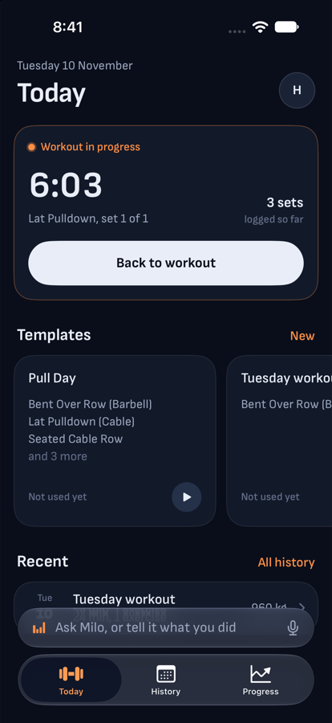
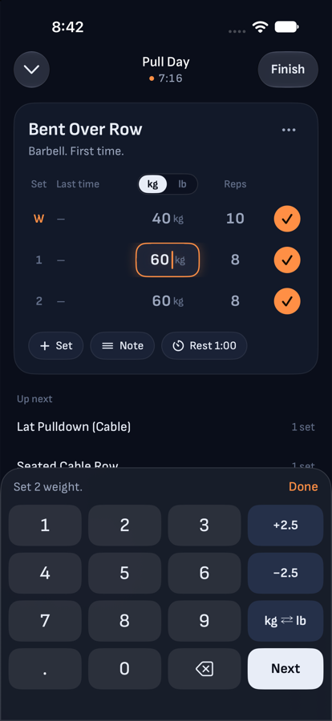
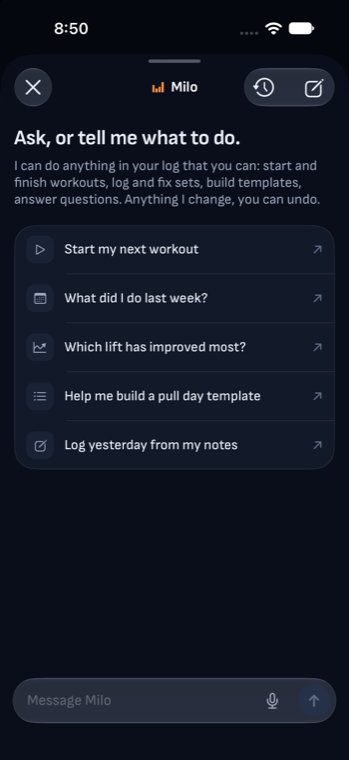

# Milo

A workout log you can talk to.

You log sets by tapping, the way you would in any lifting app. When your trainer
calls out a movement no preset list has heard of, you describe it and Milo works
out what it is, saves it as your own exercise, and logs it. Anything else you
could do by tapping (start a workout, fix a set, build a template, ask how the
month went) you can ask Milo to do instead.

<p>
  
  
  
</p>

It is a native iPhone app (SwiftUI, iOS 26) with a Go server. Logging works
offline; Milo needs a connection.

## How it's put together

- **One contract.** `proto/` defines every row and every call. `make gen` writes
  the Go server stubs and the Swift client from it, so they can't drift.
- **The phone owns the log.** Every screen reads and writes a local SQLite
  database. A sync call pushes what changed and pulls what's new; the newest
  write to a row wins.
- **Milo proposes, the phone applies.** The agent runs on the server and reads
  your log there, but never writes to it. It sends cards: rows to write, shown
  as a before and after. The phone applies a card like any other edit, can undo
  it, and syncs.
- **Numbers are computed once, twice.** Volume, estimated one-rep max, bests and
  calories are implemented in Go and in Swift, and both run the same test
  vectors from `testdata/maths`.

[docs/architecture.md](docs/architecture.md) explains each of these in a page.

## Run it

You need Go 1.27, Docker, Xcode 26, and three tools from Homebrew:

```bash
brew install bufbuild/buf/buf sqlc xcodegen
```

Then:

```bash
cp .env.example .env    # set MILO_INVITE_CODE to anything; add an Anthropic key to talk to Milo
make up                 # Postgres on port 5433
make run                # the API on :8080; it migrates the database on start
make ios                # generates the Xcode project and opens it; press Run
```

In the app, create an account with the invite code from your `.env`. Without an
Anthropic key everything works except Milo, which says it isn't set up.

## Everyday commands

| Command | What it does |
| --- | --- |
| `make gen` | Regenerates Go and Swift code from `proto/`, and typed queries from the SQL |
| `make test` | Server tests. They start a real Postgres in Docker, so Docker must be running |
| `make ios-test` | App tests on a simulator |
| `make lint` | `buf lint` and `go vet` |
| `make live` | Runs Milo against the real Claude API. Costs about 40 cents a run |

## Where things are

```
proto/milo/          The contract: rows (common), sync, auth, and Milo's cards (agent)
backend/
  cmd/api/           The server's main
  internal/agent/    Milo: the tool loop, one file per group of tools, the prompt
  internal/sync/     Push and pull
  internal/auth/     Accounts and sessions
  internal/maths/    Volume, e1RM, bests, calories
  internal/db/       Migrations (goose) and queries (sqlc)
  internal/rows/     Database rows to API messages, in one place
ios/
  Milo/App/          The app's entry point and shared state
  Milo/Data/         The local database, sync, and applying Milo's cards
  Milo/Domain/       Maths and formatting, no UI
  Milo/DesignSystem/ Colours, type, motion, buttons, shared pieces
  Milo/Features/     One folder per screen
  MiloAPI/           The generated client, as its own framework
testdata/maths/      Test vectors both codebases run
```

## Working on it

[CONTRIBUTING.md](CONTRIBUTING.md) has the conventions and step-by-step recipes
for the common changes: a new tool for Milo, a new field on a synced row, a
change to the maths. [PRODUCT.md](PRODUCT.md) says who Milo is for and what it
will and won't be.
